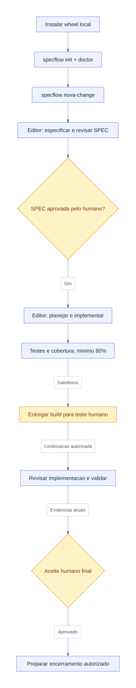

# SpecFlow CLI — guia de execução

Copyright (c) 2026 Rômulo Penha. MIT para o material autoral.

Estado em 14/11/2026: SPECs aprovadas e pacote local implementado. A instalação Windows foi exercitada em ambiente isolado, sem alterar o perfil pessoal. [Entrega, hashes, resultados e limites](ENTREGA-0.1.0.md). Contrato congelado na [Change 10031](../../specs/changes/10031-criar-specflow-cli/proposal.md); seu cabeçalho histórico não substitui o registro de aprovação.

## Instalação local

Uv é recomendado, não obrigatório. Pacote Python padrão, Python >=3.11, runtime com stdlib. Primeiro distribuir wheel local, sem publicação ou instalação pessoal automática:

```powershell
uv tool install specflow-cli
specflow init meu-projeto --integration copilot
cd meu-projeto
specflow doctor
specflow nova-change "Criar cadastro de clientes"
```

Para instalar as duas integrações, repetir --integration codex no init. Sem flag, somente estrutura comum. Em projeto existente, usar specflow init .; nenhum arquivo autoral é sobrescrito silenciosamente. Após publicação futura expressamente autorizada e disponibilidade do nome confirmada, a instalação por índice poderá ser uv tool install specflow-cli. Atualizar o CLI não modifica consumidores.

Ajustes técnicos da revisão corrente: init da mesma versão pode acrescentar Codex a um consumidor já inicializado com Copilot, preservando os arquivos existentes. doctor retorna 0 com opcionais em DEFINIR e informa que estão inativos. nova-change seguida de contexto retorna RASCUNHO/0; implementar continua bloqueado até contrato aprovado e plano. [Tratamentos e critérios](AJUSTES-TECNICOS.md), [ADR proposto](../adr/ADR-001-cli-local-e-gates.md).

## Terminal e editor

O terminal prepara arquivos, reconcilia contexto e verifica gates. O agente no editor executa o desenvolvimento. O comando de terminal imprime a instrução correspondente e informa phaseExecuted=false; isso não prova que a fase foi executada. As instruções são os onze [comandos existentes](../comandos/COMANDOS.md), com mapeamento de nomes único no catálogo.

| Terminal | Editor | Limite |
| --- | --- | --- |
| specflow contexto --change ID | specflow-contexto | leitura do contexto real |
| specflow especificar --change ID | specflow-especificar | contrato, sem código |
| specflow esclarecer --change ID | specflow-esclarecer | resolver ambiguidades |
| specflow revisar-spec --change ID | specflow-revisar-spec | revisão técnica e pacote de decisão |
| specflow planejar --change ID | specflow-planejar | exige SPEC aprovada vigente |
| specflow implementar --change ID | specflow-implementar | exige plano, testes e cobertura |
| specflow teste-humano --change ID | specflow-teste-humano | orientar até entrega técnica e parada humana |
| specflow revisar-implementacao --change ID | specflow-revisar-implementacao | confronto com SPEC e evidências |
| specflow validar --change ID | specflow-validar | entrada válida + gate confiável de segurança; não executar comandos do JSON |
| specflow aprovar --change ID | specflow-aprovar | decisão humana permanece explícita |
| specflow encerrar --change ID | specflow-encerrar | não mover/commitar automaticamente |

No Copilot, usar / antes do nome de editor; no Codex, usar $. Alias speckflow-teste-humano preservado no editor. Suporte visual/discovery de cada cliente exige homologação real. check/evaluate expõem operações determinísticas do núcleo. Flags comuns: --help, --version, --project e --json; códigos 0/1/2 distinguem operação satisfeita, pendência e erro.

## Fluxo de execução



[Fonte Mermaid](fluxo-cli.mmd) e [PNG](fluxo-cli.png). Caminho de sucesso: falha ou pendência interrompe o avanço e retorna à correção da etapa responsável. Azul indica trabalho técnico; amarelo, decisão/parada humana. O diagrama descreve a divisão de responsabilidades, não execução automática pelo terminal. Publicação não faz parte desse fluxo.

configuracao.properties começa sempre em DEFINIR; recursos incompletos não são ativados. Código de aplicação vai para apps na geração autorizada. Testes/cobertura mínima de 80% por arquivo e agregado antecedem IMPLEMENTADA; segurança pendente impede VALIDADA. Teste humano pode parar antes das fases formais posteriores; resultado positivo não autoriza encerramento.

## Distribuicao publica confirmada

Use uv tool install specflow-cli. Publicacao da Change10032 verificada no PyPI; hashes de wheel/sdist iguais ao build revisado; quinze operacoes de instalacao/CLI passaram. Windows/Linux Python3.11/3.14 exercitados no CI. Documentacao do pacote da tag0.1.0 e evidencias antigas continuam historicas; nao republicar essa versao para alterar README.
