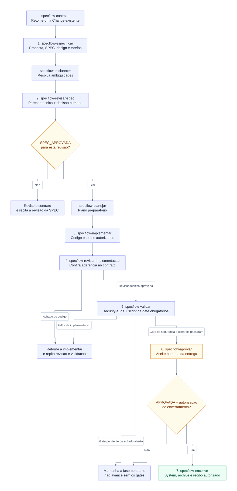
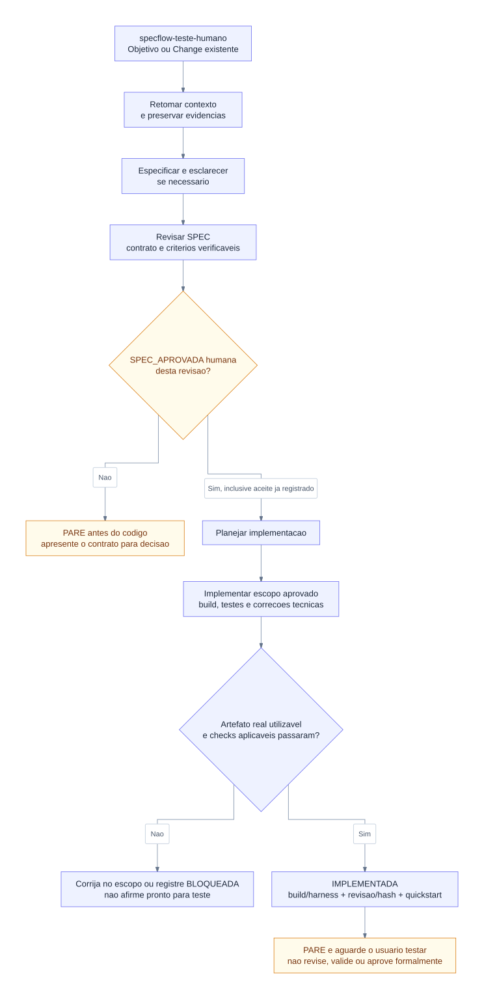

# Comandos SpecFlow

Copyright (c) 2026 Rômulo Penha. Licença MIT para estes comandos autorais.

São instruções locais para o agente executar uma fase, não um executável de shell ou um motor de workflow já implementado. O núcleo da Change 10029 continua aguardando aprovação humana da SPEC.

Leia o [registro das regras consolidadas](../../specs/shared/process/regras-consolidadas.md) e a [política de cobertura](../../specs/shared/testing/coverage-policy.md): testes codificados/executados e cobertura atual mínima de 80% por arquivo/escopo implementado, meta 90%, são obrigatórios antes de IMPLEMENTADA e IMPLEMENTACAO_APROVADA. Valores acima de 90% são válidos. LLM, teste manual ou dispensa da validação formal não substituem esse gate; falta de medição bloqueia.

## Como chamar

No **Codex**, use a Skill com `$` e informe o objetivo ou caminho:

```text
$specflow-contexto specs/changes/10029-criar-nucleo-specflow
$specflow-revisar-spec specs/changes/10029-criar-nucleo-specflow
```

No **Copilot Chat do VS Code**, use o prompt local com `/`:

```text
/specflow-contexto specs/changes/10029-criar-nucleo-specflow
/specflow-revisar-spec specs/changes/10029-criar-nucleo-specflow
```

As definições estão em `.agents/skills/specflow-*/SKILL.md` e `.github/prompts/specflow-*.prompt.md`. Se a sessão atual ainda não as listar, reabra a sessão/recarregue a janela para atualizar a descoberta. A sugestão no seletor depende do cliente; o conteúdo local pode ser lido e invocado pelo caminho. Não digite esses nomes no PowerShell como se existisse um binário `specflow` instalado.

## Fases, entradas e resultados

| Comando | Quando usar | O que entrega / condição de avanço |
| --- | --- | --- |
| `specflow-contexto` | Retomar uma Change | Fase observada, evidências, conflitos e próximo gate; não muda estado |
| `specflow-especificar` | Iniciar/revisar contrato | proposal, spec, DESIGN e tasks com RF/CA; EM_REVISAO_SPEC |
| `specflow-esclarecer` | Resolver lacunas do contrato | Perguntas materiais, respostas registradas e nova revisão quando necessário |
| `specflow-revisar-spec` | Conferir contrato antes de código | Achados REV e recomendação técnica; SPEC_APROVADA exige decisão humana atual |
| `specflow-planejar` | Após SPEC_APROVADA | implementation-plan com impactos, testes e riscos; não altera contrato |
| `specflow-implementar` | Contrato aprovado e plano pronto | Código/testes previstos, tarefas e estado real; sem aceite automático |
| `specflow-teste-humano` | Conduzir desde objetivo/Change até resultado testável | Respeita SPEC_APROVADA, planeja, implementa, faz checks técnicos e entrega build/harness + roteiro; para em IMPLEMENTADA aguardando o usuário |
| `specflow-revisar-implementacao` | Implementação entregue | IMP-REV e aderência; achado material retorna para correção |
| `specflow-validar` | Padrão da fase de validação, com IMPLEMENTACAO_APROVADA | VAL e auditoria security-audit + script do gate; fase só omitida por prompt explícito, registrada como não executada, sem VALIDADA |
| `specflow-aprovar` | Evidências e teste manual suficientes | Decisão humana APR para a mesma revisão; testes verdes não bastam |
| `specflow-encerrar` | APROVADA e ações autorizadas | System, archive e recibo do encerramento efetivo; Git apenas se aplicável/autorizado |

## Ordem de execução



Fonte editável: [fluxo-comandos.mmd](fluxo-comandos.mmd). Azul representa trabalho técnico; amarelo destaca decisão humana; verde indica encerramento autorizado. Esclarecimento e planejamento são auxiliares, sem alterar as sete fases canônicas. `contexto` pode ser usado em qualquer retomada; o diagrama o mostra no início.

Para uma Change nova, chame `especificar`, depois `esclarecer` se houver ambiguidade e `revisar-spec`. **Só depois do aceite humano da revisão** use `planejar` e `implementar`. Execute os comandos seguintes conforme cada entrada estiver satisfeita; não é uma sequência que ignora falhas. Se um contrato aprovado mudar, volte à revisão da SPEC. Falha de requisito retorna a especificar/esclarecer; falha de código ou teste retorna a implementar. Invocar `aprovar` solicita conduzir a etapa de decisão, não constitui por si só aprovação do resultado.

Em `specflow-validar`, chame a skill security-audit e execute `python -B docs/security-audit/verificar_seguranca.py --change <Change>`. O relatório e o gate devem refletir a implementação atual; qualquer achado aberto, check incompleto/falho ou erro mantém a fase pendente. [Contrato do gate e códigos](../security-audit/GATE-SEGURANCA.md). O gerador de PDF é apenas apresentação dos dados, não verificação de segurança.

**Execução padrão:** quando o fluxo autorizado alcançar a validação da implementação, `specflow-validar` será chamado sem você precisar solicitá-lo separadamente. Para omitir, o prompt deve dizer explicitamente algo como “não execute a fase de validação da implementação”. Nesse caso, registrar a solicitação, o motivo, a revisão e “fase não executada por solicitação” em validation.md e na memória. Isso não é VALIDADA nem libera aprovação/encerramento. “Não gerar PDF” ou a falha de uma ferramenta não dispensa a fase. O limite explícito de `specflow-teste-humano` permanece: ele para antes de chegar à validação formal. Comandos de fase única continuam restritos à fase invocada.

Na Change 10029, comece por `specflow-contexto` e `specflow-revisar-spec`; não crie outra Change para retomar o mesmo núcleo. Neste workspace sem Git, encerramento não pode inventar commit ou inicializar repositório implicitamente. Publicação é sempre operação separada.

## Manutenção

Catálogo fonte: [comandos.json](comandos.json). Há 11 comandos canônicos e um alias, materializados em 24 arquivos de Skills/prompts. `python -B tools/gerar_comandos_specflow.py --check` confere esses arquivos sem executar as fases. A materialização inicial usa o mesmo script sem `--check` e recusa sobrescrever conteúdo divergente. Validar esses arquivos não comprova comportamento do agente ou integração visual dos clientes.

## Entrega para teste humano em um comando

```text
$specflow-teste-humano specs/changes/10029-criar-nucleo-specflow
```

No Copilot, use `/specflow-teste-humano`. A grafia solicitada `speckflow-teste-humano` também está disponível como alias em ambos os clientes.

O comando composto retoma a Change, prepara/esclarece o contrato se necessário, conduz sua revisão e **aguarda SPEC_APROVADA humana antes do código**. Se já houver aprovação válida da mesma revisão, não pede novamente. Depois prepara o plano, implementa, codifica/executa testes, mede cobertura mínima de 80% (meta 90%) e faz os checks técnicos. Só então entrega um resultado executável identificado por revisão/hash e relatório atual, com quickstart.md e cenários para o usuário testar. Sem testes/cobertura suficientes, não afirmar pronto ou IMPLEMENTADA.

A parada é **IMPLEMENTADA, teste humano pendente**. Não executa revisão formal da implementação, validação formal, aprovação, system, archive, commit ou publicação. Checks de build/testes durante a implementação não equivalem a essas fases. Se não conseguir disponibilizar artefato real por falta de dependência/ambiente, registra BLOQUEADA e o motivo; não afirma pronto para teste. Falhas relatadas pelo usuário retornam à mesma Change para correção e nova entrega, respeitando o contrato vigente.



[Diagrama editável](fluxo-teste-humano.mmd) e [PNG](fluxo-teste-humano.png). O fluxo completo acima continua disponível para as fases posteriores, mediante pedido próprio; este comando não as dispara por receber um relato positivo.
