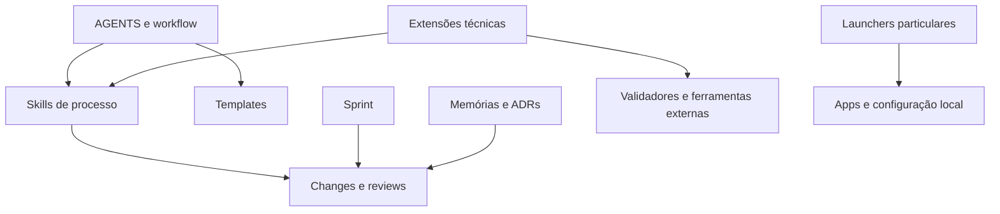

> Copia editorial neutralizada. Metricas e verificacoes abaixo sao historicas; originais exatos foram preservados em arquivo externo de auditoria. Links locais mostram recursos atuais, nao provam igualdade com o original.

# Mapa de dependências e propriedade

| Origem | Destino | Tipo e evidência | Efeito da separação |
| --- | --- | --- | --- |
| AGENTS | workflow e regras técnicas | Normativo; E01/E02 | Extrair regras comuns; configurações de stack ficam no consumidor |
| Skills de processo | artefatos da Change + workflow | Contratual; E04/E05 | Receber raiz/caminhos explicitamente; preservar gates |
| Prompts/agente | skills de processo | Orquestração textual; E06/E32 | Adaptador do provedor, sem autoridade adicional |
| Sprint | Changes e reviews | Planejamento; E19 | Referenciar IDs estáveis; Sprint não promove estado |
| Templates | políticas + valores de projeto | Geração documental; E34 | Assets versionados e parâmetros; documento autorado pertence ao consumidor |
| Android base | seis sub-skills, referências, Python/Gradle | Especialização; E16/E17 | Pacote B com recursos transitivos e versões suportadas |
| Go/Java skills | convenções, bibliotecas e ferramentas locais | Especialização; E31/E33 | Dependências de stack fora do core |
| Geradores | templates BAT + chaves externas + apps/backend | Runtime e escrita; E14/E15 | Scripts atuais C; mecanismo possível B; nunca copiar chaves |
| Sonar | Docker/Compose/PostgreSQL/Sonar/Maven/npm | Runtime operacional; E11/E12 | Adaptador B; não depender dessas ferramentas para ler workflow |
| Memória | tasks, reviews, ADR, Git e pendências | Conhecimento do projeto; E22 | Fonte local com referências e conflitos; sem consolidação global automática |
| Hashes de importação | arquivos diretos copiados | Integridade de bytes; E30 | Acrescentar verificação de referências/licença/execução |

O Mermaid é fonte explicativa, sem renderização validada nesta missão; a tabela é o mapa canônico legível. O anexo [reference-edges.json](../specs/changes/10028-investigar-specflow-framework/evidence/reference-edges.json) contém 599 vínculos Markdown identificados automaticamente. Não confundir links com importações de código. Caminhos em backticks e dependências operacionais foram examinados nas fontes selecionadas; não se alega grafo estático completo de aplicações.
